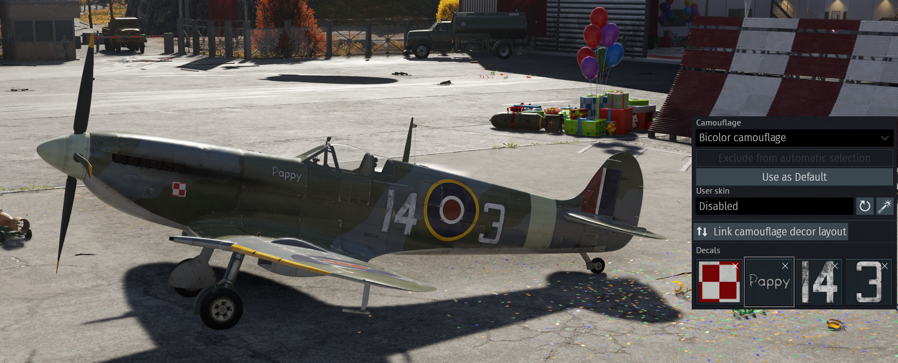
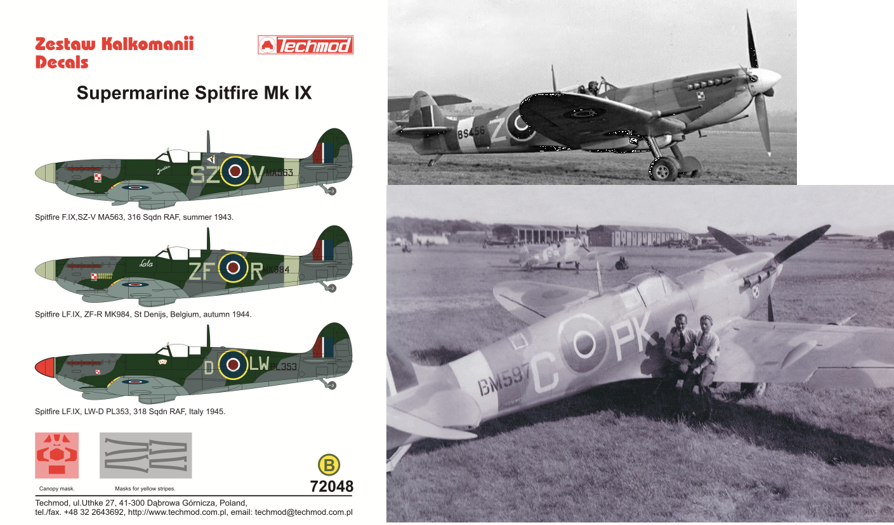
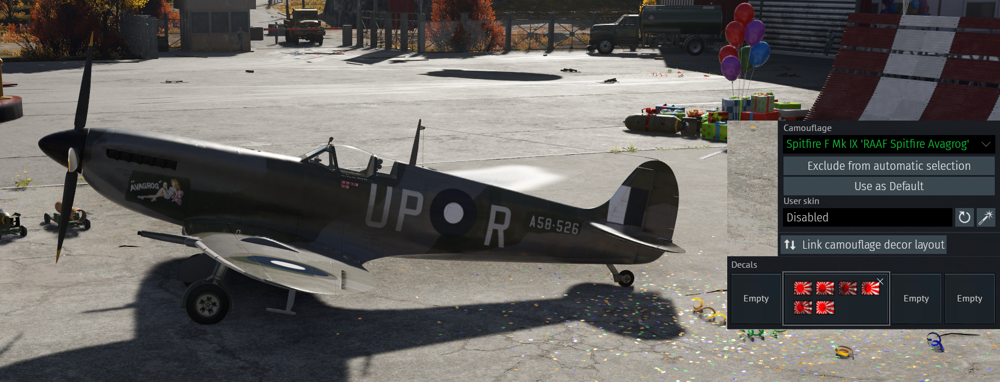
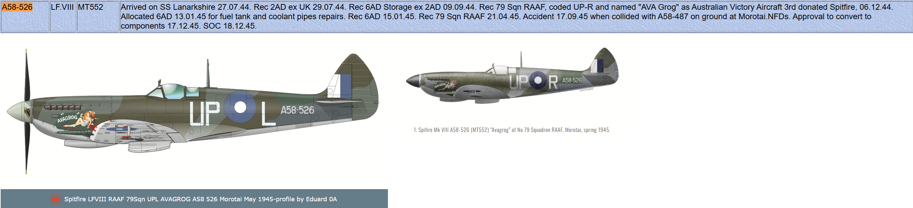
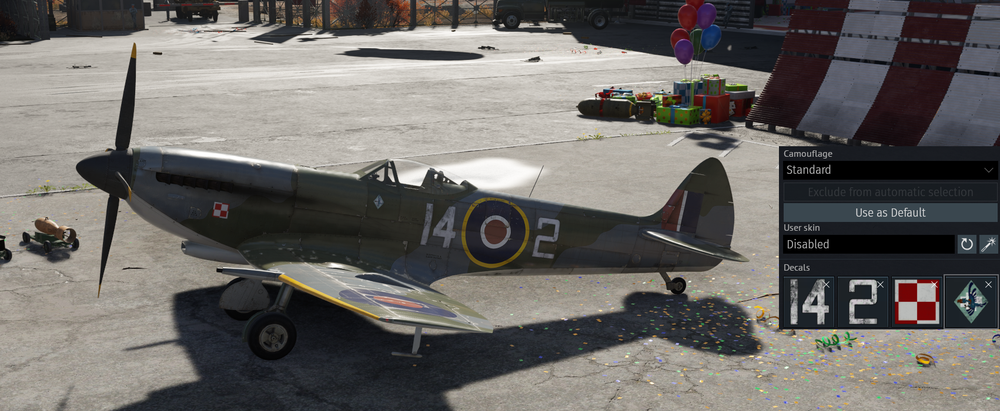
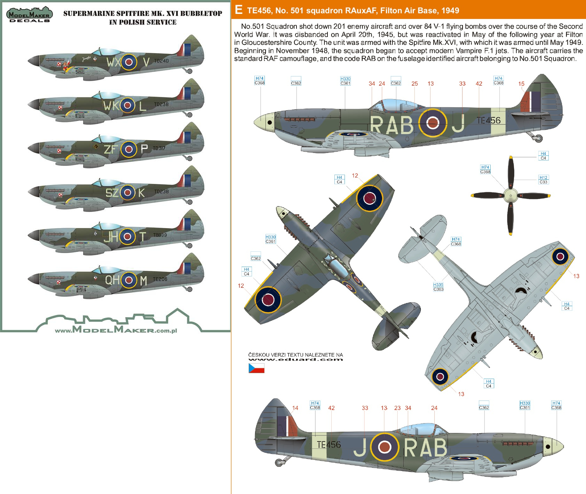
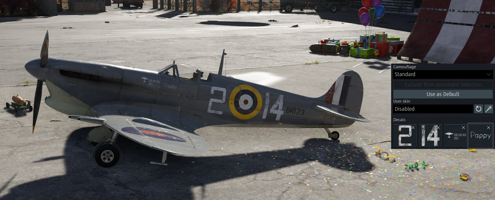
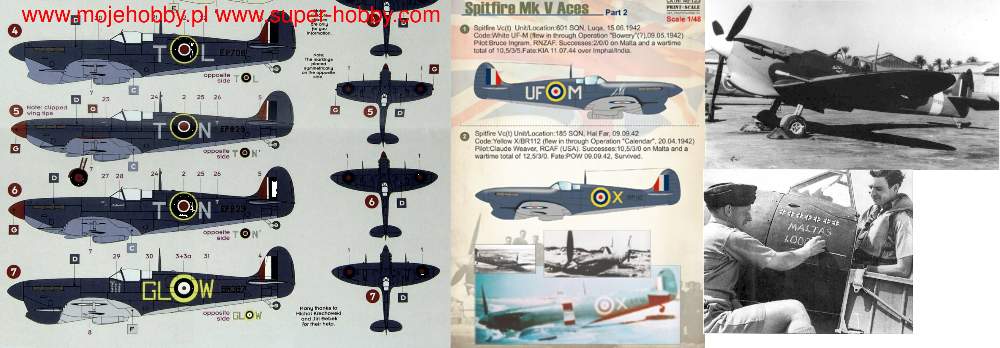
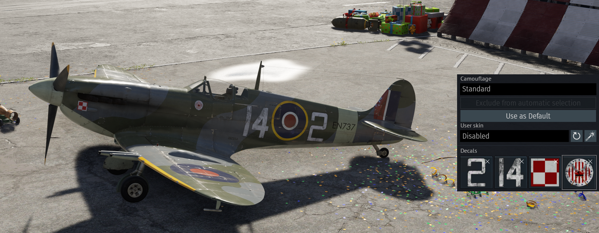
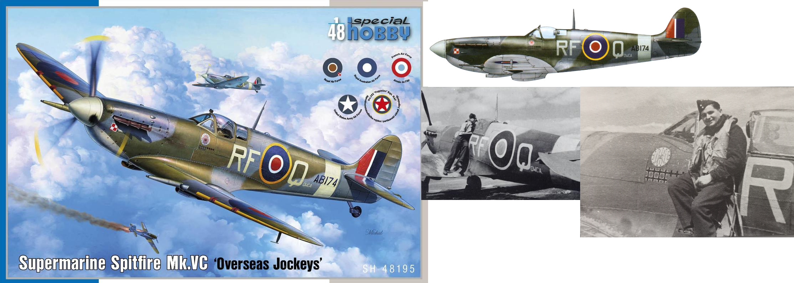

# Typhon Mk 1b/L

# Spitfire F Mk IX

# Spitfire F Mk XVI

# Spitfire Mk Vc/trop

# Spitfire Mk Vc

# Firefly F Mk I

# Firefly FR Mk V

# Seafire LF Mk.III

# Mosquito FB Mk VI

# Mosquito FB Mk XVIII

# Mosquito NF.Mk.II

# Mosquito TR.Mk.33

# Brigand B 1

# Whirlwind Mk I

# Halifax B Mk IIIa

# Stirling B Mk I

# Stirling B Mk III

# Mosquito B.Mk.XVI

